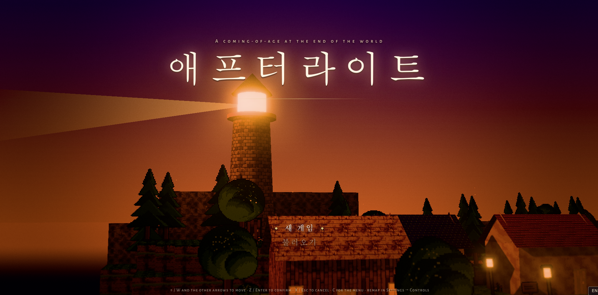
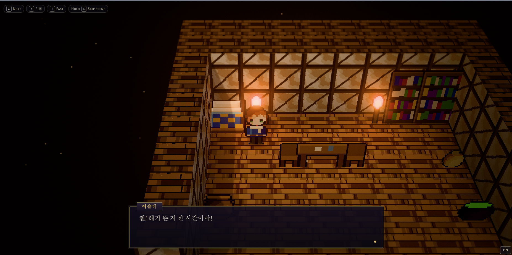

# Afterlight — 한국어판 (비공식)

*세상이 끝난 날, 나는 열여섯이 되었다. 이 이야기는 그 뒤에 우리가 세운 것에 대한 것이다.*

three.js로 만든 2D-HD JRPG **Afterlight**를 한국어로 옮긴 비공식 한국어판입니다. 원작 소스는 그대로 두고,
영어 원문을 키로 하는 번역 사전을 덧씌우는 **오버레이 방식**으로 번역했습니다.

- **플레이(배포)**: <https://sigco3111.github.io/afterlight-ko/>
- **한국어판 저장소**: <https://github.com/sigco3111/afterlight-ko>
- **원작**: FriendlyUser — <https://github.com/FriendlyUser/afterlight> · <https://friendlyuser.github.io/afterlight/>
- **용어집**: [docs/glossary.md](docs/glossary.md)

## 게임 소개

픽셀 아트 캐릭터를 조명과 심도 표현이 들어간 디오라마 위에 올린 2D-HD JRPG입니다. 열여섯 살에 세상의 끝을
불러온 소녀가 그럼에도 자라나는 이야기로, 원작 기준 다음을 담고 있습니다.

- **이야기**: 3막 14장(약 7만 4천 단어 분량의 장면), 엔딩 2종, 포스트게임 30층 심연 「어둑빛 나락」.
  75초 오프닝 무비가 있으며, 타이틀 화면을 그대로 두어도 재생됩니다.
- **전투**: 턴 순서 타임라인, 포이즈/브레이크, 애프터글로우 게이지(서지·링크 아츠), 보스 예고 공격(가드 또는
  브레이크로 끊기), 전투 중 파티 교체, 오토 배틀, 패스트 모드.
- **크레스트(클래스)**: 28종(8개 소명 · 10개 직조 · 6개 전설 · 4개 상실) × 10랭크, 주/보조 크레스트,
  300개 이상의 기술, 숙련 후 남는 레거시, 숙련 이후 5단계 승천.
- **탐험**: 직접 배치한 145개 맵, 따라오는 파티, 퀘스트 가이드, 미니맵·지역 지도·월드 맵, 패스트 트래블,
  탈것 Kindle(랜턴빛 뿔을 가진 엠버하트), 낚시, 마을별 곁가지 퀘스트, 수렵 길드 게시판(10+2 수렵),
  선택 던전 4곳, 투기장 3곳, New Game+.
- **연출**: three.js 기반 2D-HD 렌더링(블룸, 틸트시프트 심도, 컬러 그레이딩), 절차 생성 픽셀 아트,
  WebAudio 사운드트랙 30곡.
- **세이브**: 6슬롯 + 자동 저장. 세이브/로드 화면에서 슬롯에 커서를 두고 F로 파일로 내보내기·불러오기.

## 실행 화면

[배포본](https://sigco3111.github.io/afterlight-ko/)에서 캡처한 실제 실행 화면입니다.

| 타이틀 | 인게임 대사 |
|:-:|:-:|
|  |  |
| 한글 제목 「애프터라이트」와 새 게임·불러오기 메뉴가 표시된 타이틀 화면입니다. | 챕터 1 오프닝. 이솔데의 대사가 한국어로 표시됩니다. |

## 한국어판 특징

### 번역 범위

아래는 `i18n/parts/` 의 82개 사전 파일을 실제로 세어 집계한 값입니다(2026-11-15 기준).

| 영역 | 항목 수 | 사전 파일 |
|---|---:|---|
| 1~14장 대사·목표·일지·선택지 | 6,457 | `ch1a` … `ch14a`, `ch3_side1·2`, `ch4a_mountain1·2·3`, `ch4b_sky1·2·3`, `ch4b_verdance1·2·3`, `ch9side`, `0side-a` |
| 포스트게임 대사·나레이션 | 304 | `pg-a`, `pg-b` |
| 등장인물·장 제목 | 222 | `names`, `chars-a`, `ch89-names`, `ch1112-names`, `pg-names` |
| 지도·지명 | 504 | `maps-names` |
| 스킬·크레스트 기술 | 370 | `skills-a` … `skills-h` |
| 장비 이름·설명 | 378 | `equip-names-a·b·c`, `eq-desc` |
| 적 이름·설명 | 52 | `enemies-a·b·c` |
| 크레스트 이름·설명 | 75 | `crests-a`, `crests-b` |
| 아이템·UI·전투 튜토리얼 | 245 | `items`, `ui`, `ui2`, `tutorial-battle` |
| **합계** | **8,607** | 82개 파일 |

곁가지 콘텐츠도 함께 번역했습니다: 투기장(콜로세움·스크랩 아레나), 수렵 게시판, 낚시, 탈것, 마을 곁가지 퀘스트.

### 번역 방식

```
i18n/parts/*.json   (영어 원문 → 한국어, 평면 사전 82개 파일)
        │  node tools/merge-ko.mjs
        ▼
src/i18n/ko.json    (병합된 사전: 키 = 영어 원문 문자열)
        │  npx vite build --base=./
        ▼
dist/               (GitHub Pages 배포본)
```

사전은 **평면 구조**입니다. 키가 영어 원문 한 줄이고 값이 한국어이며, 문장을 코드에 손대지 않고 치환합니다.
게임 쪽 연결은 세 갈래입니다.

- `src/i18n/index.js` — `t()` / `fmt()` 조회와 언어 결정(`?lang=ko|en`, `localStorage.afterlight.lang`, 기본 한국어).
- `src/i18n/dom.js` — 화면에 그려진 텍스트 노드를 `MutationObserver`로 감시해 사전 값으로 바꾸고, 우하단에 **EN / 한글** 토글 버튼을 붙입니다.
- `src/i18n/data.js` — 아이템·장비·스킬·적·크레스트·상태·패시브·튜토리얼 데이터의 표시 문자열(`name`/`desc`/`title`/`text`/`label`/`hint`/`summary`/`flavor`)을 로드 직후 치환합니다. id는 그대로라 게임 로직에 영향이 없습니다.

대사는 `src/script/ScriptContext.js`의 `fill()`과 `src/ui/UI.js`의 대사 출력 한 곳에서 번역되므로, 사전에 없는
문장은 **영어 그대로** 표시되고 게임은 깨지지 않습니다.

### 총 항목 수

- 사전 파일: **82개** (`i18n/parts/*.json`)
- 항목(키) 합계: **8,607개**
- 서로 다른 키: **7,824개** (같은 영어 원문이 여러 파일에 나오면 하나로 합쳐집니다)

### 언어 바꾸기

- 화면 오른쪽 아래 **EN / 한글** 버튼
- 주소에 `?lang=ko` 또는 `?lang=en` 붙이기
- 콘솔에서 `localStorage.setItem("afterlight.lang","en")` 후 새로고침

선택은 `localStorage`에 남고, 저장 파일과는 별개입니다.

### 폰트

한글은 시스템 폰트(맑은 고딕, Apple SD Gothic Neo, Noto Sans KR, 나눔고딕)를 우선 사용합니다(`css/ko.css`).
추가 웹폰트를 내려받지 않습니다. 영어로 전환하면 원작의 Alegreya / Alegreya Sans SC / Cinzel이 그대로 쓰입니다.

## 아직 영어로 남은 부분

- **코드가 문자열을 조립하는 곳.** `t()`는 완성된 문자열을 사전에서 찾으므로, 이름·수치를 끼워 만드는 문장은
  사전과 맞지 않아 영어로 나옵니다. `src`(i18n·data 제외)에서 사전을 거치지 않는 템플릿 문자열을 훑으면
  **141줄**이고, 그중 10줄은 디버그·경고 전용(예: `Unknown prop type: …`, `Expectation failed: …`)입니다.
  화면에 보이는 대표적인 예:
  - 전투 로그 — ``${user.name} hesitates.``, ``Recovered ${g} gold from ${target.name}.``, ``${coverer.name} covers ${target.name}!``
  - 전투 UI — `Support Points ${r.supportFrom} → ${sp}`, ` EXP ${summary.exp} Gold ${summary.gold} CP ${summary.cp} `
  - 시스템 — `Fast Mode ×${s.fastSpeed || 3}`, `Load last save — ${last.location || "saved game"}`
  - 곁가지 목표·알림 문구 — `src/story/postgame.js`(13줄), `src/story/colosseum.js`(11줄), `src/story/hunt.js`(7줄), `src/story/side.js`(7줄)
- **사전에 없는 문장.** 원작이 새로 추가한 문장이나 아직 넣지 않은 문장은 영어로 표시됩니다.
- **개발자용 문자열.** 콘솔 경고·테스트 하네스 메시지는 번역 대상이 아닙니다.

## 조작법

| 동작 | 키보드 | 게임패드 |
|---|---|---|
| 이동 | 방향키 / W A S D | 십자 패드 · 왼쪽 스틱 |
| 달리기(누르고 있기) | Shift | X |
| 확인 · 대화 · 조사 | Z Enter Space | A |
| 취소 · 뒤로 | X Backspace Esc | B |
| 메뉴 열기 | C Tab Esc | Y / Start |
| 선두 교체(필드) · 서지(전투) | Q / E | LB / RB |
| 백로그(최근 100줄, 대화 중) | ↑ | 십자 패드 위 |
| 장면 건너뛰기(1초 누르기) | C Tab Esc | Y / Start |
| 오토 배틀(전투) · 최적화(장비) · 내보내기/불러오기(세이브) | F | Back |
| 패스트 모드 켜기/끄기(2~4배속, 설정에서 배율) | T | 왼쪽 스틱 클릭 |

기본 키이며 **설정 → 조작**에서 동작마다 최대 3개까지 다시 지정할 수 있습니다. Esc는 항상 취소·메뉴입니다.
키 설정은 저장 파일과 함께 저장·이동됩니다.

새 게임을 시작하면 난이도(스토리 / 보통 / 어려움)를 고르고, 이후 설정에서 언제든 바꿀 수 있습니다. 글자 크기와
속도, 자동 넘김, 장면 힌트, 조우율, 전투 속도, 패스트 모드 배율, 미니맵, 퀘스트 가이드, 화면 흔들림·번쩍임
줄이기도 설정에 있습니다.

## 로컬 실행 · 빌드

```bash
node tools/merge-ko.mjs      # i18n/parts/*.json -> src/i18n/ko.json (빌드 전 필수)
python3 -m http.server 8765  # 빌드 없이 실행: http://localhost:8765/
```

개발 서버에서도 사전 병합이 먼저입니다. 저장소에 들어 있는 `src/i18n/ko.json`은 마지막 빌드 산출물이라, 병합하지
않으면 일부만 번역된 상태로 보입니다.

```bash
npm install                  # 개발 도구만 설치(Vite, TypeScript)
npm run dev                  # 개발 서버 http://localhost:8766/
npx vite build --base=./     # dist/ 로 번들
npm run preview              # dist/ 미리보기 http://localhost:8767/
npm run typecheck            # JavaScript 타입 검사
```

`--base=./` 로 빌드하면 모든 경로가 상대 경로라 어떤 정적 호스팅(GitHub Pages, itch.io, Netlify 등)에서도
동작합니다. 빌드 결과는 약 3MB, gzip 기준 1MB 미만입니다.

### 배포

`.github/workflows/ko-build.yml` 이 `i18n/parts/**`, `src/**`, `css/**`, `index.html`, `tools/merge-ko.mjs` 가 바뀐
푸시(또는 수동 실행)에서 사전 병합 → `npm install` → `vite build --base=./` → 루트 절대경로 참조 검사 →
`.nojekyll` → Pages 배포를 수행합니다. **README만 바꾼 커밋은 이 경로에 걸리지 않아 재빌드되지 않습니다.**

참고로 원작에서 온 `.github/workflows/pages.yml` 은 `main` 의 모든 푸시에 반응하지만 사전 병합을 하지 않습니다.
문서만 고친 푸시 뒤에는 사이트가 일부만 번역된 빌드로 잠시 바뀔 수 있으니, 필요하면 ko-build를 수동 실행하세요.

## 크레딧

- **원작 · 게임 콘텐츠 전체**: FriendlyUser — <https://github.com/FriendlyUser/afterlight> (배포: <https://friendlyuser.github.io/afterlight/>)
- **한국어 번역 · 오버레이 · 배포**: sigco3111
- **엔진**: three.js — MIT License. `vendor/three/three.module.js` 로 포함되어 있고, 라이선스 전문은 `vendor/three/LICENSE` 에 있습니다.
- **폰트**: Alegreya, Alegreya Sans SC, Cinzel — SIL Open Font License 1.1. 전문은 `fonts/OFL-alegreya.txt`, `fonts/OFL-alegreyasanssc.txt`, `fonts/OFL-cinzel.txt` 에 있습니다.
- **개발 도구**(`package.json` devDependencies, 배포물에는 포함되지 않음): Vite 6(MIT), TypeScript 5(Apache-2.0), @types/three(MIT).

## 라이선스 · 원작 표기

- 원작 저장소(<https://github.com/FriendlyUser/afterlight>)에는 **라이선스 파일이 없습니다**(저장소 루트에 LICENSE 없음, GitHub 라이선스 정보도 없음).
- 이 저장소 역시 별도의 라이선스 파일을 두지 않았습니다. 원작의 권리는 원작자에게 있습니다.
- 제3자 구성 요소(three.js, 폰트)의 라이선스 텍스트는 원작과 같은 위치에 그대로 보존했습니다.
- 원작자의 명시적 허락 없이 공개한 비공식 번역판입니다. **원작자(FriendlyUser)가 삭제를 요청하면 이 저장소와 배포 페이지를 즉시 내립니다.**

## 번역 외 변경 사항

- 추가: `src/i18n/index.js`, `src/i18n/dom.js`, `src/i18n/data.js`, `css/ko.css`, `tools/merge-ko.mjs`, `tools/patch-i18n.mjs`, `.github/workflows/ko-build.yml`
- 수정: `src/main.js`(`installI18n()`·`localizeData()` 호출), `src/ui/UI.js`·`src/script/ScriptContext.js`(문자열을 `t()` 경유), `index.html`(`css/ko.css` 링크)
- 산출물: `src/i18n/ko.json` — `tools/merge-ko.mjs`가 만드는 병합 사전(커밋되어 있음)
- 문서: `README.md`, `README.en.md`, `docs/glossary.md`(용어 표기)
- 게임 로직·데이터·에셋·저장 형식은 바꾸지 않았습니다. 사전에 없는 문자열은 영어로 통과합니다.

## 검증 기록 (2026-11-15)

- `i18n/parts/` 82개 파일의 키를 스크립트로 직접 세어 **8,607개 / 고유 7,824개**를 확인했습니다.
- 병합 시 같은 키가 783번 겹치고, 그중 값이 다른 경우가 454번입니다. `merge-ko.mjs`는 파일 이름 정렬 순서로
  뒤에 오는 값을 채택하며, 겹치는 키는 경고만 남깁니다.
- `t()`를 거치지 않는 템플릿 문자열을 `src`에서 훑어 141줄(디버그·경고 10줄 포함)을 확인했습니다.
- 최근 ko-build 실행이 성공했고(2026-11-15 05:56 KST), 배포본이 정상 동작하는 것을 확인했습니다.
- ko-build는 `i18n/parts/**`, `src/**`, `css/**`, `index.html`, `tools/merge-ko.mjs` 변경에만 반응하므로
  이 문서만 고친 커밋으로는 재빌드가 일어나지 않습니다.
- 워크플로가 빌드 결과에서 `src="/…"`, `href="/…"` 형태의 루트 절대경로 참조를 검사하고, 발견되면 배포를 중단합니다.
